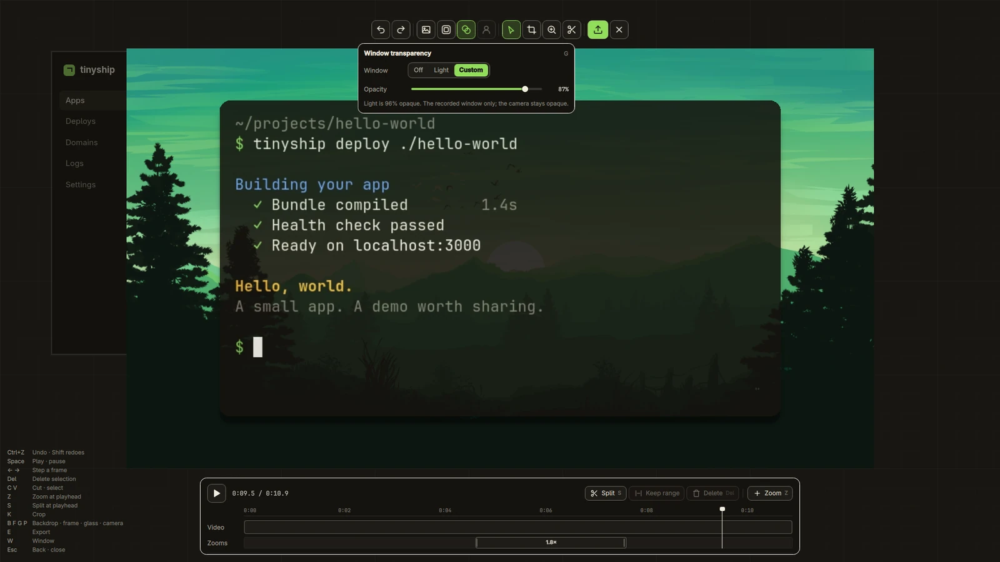
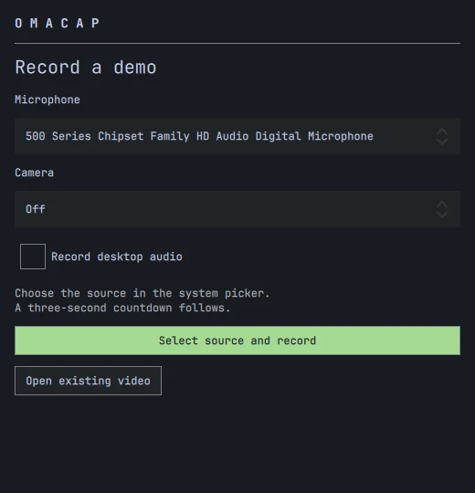
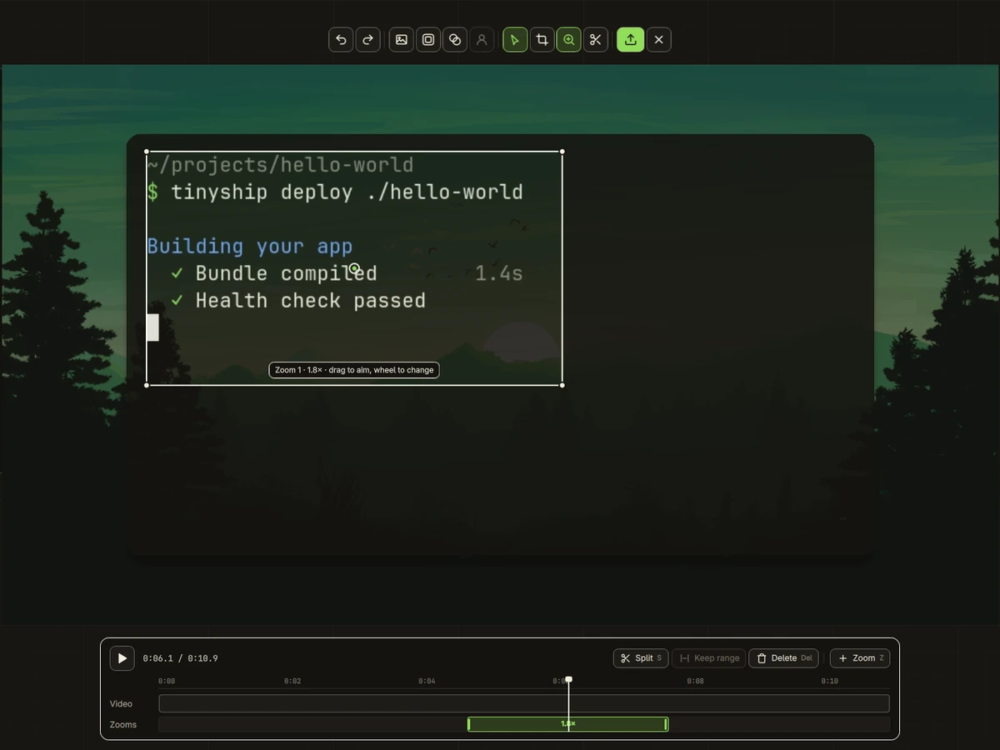
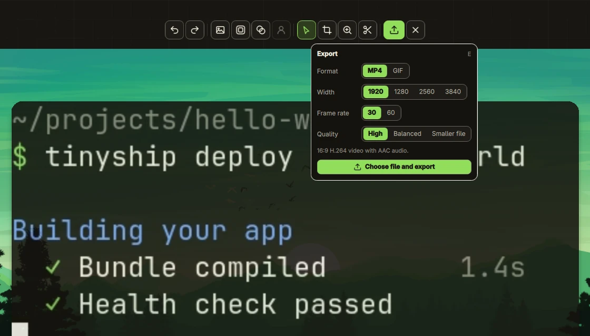

# OmaCap

Screen recordings worth sharing. Made for Omarchy.

Record a window, clean up the take, and give it a background, padding and smooth zooms. Export an MP4 or GIF for a demo, tutorial or product update. Everything stays on your computer.

[Install](#install) · [How to use it](#record-and-edit) · [MIT license](https://github.com/allisonmahmood/omacap/blob/main/LICENSE)



*The real OmaCap editor, shown with a generated terminal demo.*

## A short edit, then you're done

- **Make it look right.** Crop the recording, add padding, soften the corners and set a shadow. Your current Omarchy wallpaper is the default background; you can choose another image or a solid color.
- **Keep the useful parts.** Trim the start and end, remove mistakes in the middle, and undo an edit when you change your mind.
- **Zoom on purpose.** Keep the whole window visible by default. Add a zoom section, choose its focus, and adjust its timing on the timeline.
- **Include yourself when you want.** Record your microphone, desktop audio and camera. Move the camera overlay, choose rounded corners or a circle, add a shadow, and mute either audio track.
- **Take the file anywhere.** Export MP4 or GIF with your chosen size and frame rate. No account, upload or project library.

The controls follow your Omarchy theme. Changing themes updates the app without changing the video you're editing.

## Install

Download the x86_64 `.pkg.tar.zst` file and `SHA256SUMS` from the [latest GitHub release](https://github.com/allisonmahmood/omacap/releases/latest). In the download directory, verify and install the package:

```sh
sha256sum --check --ignore-missing SHA256SUMS
sudo pacman -U ./omacap-*.pkg.tar.zst
```

Keep only the package version you want to install in that directory. Pacman installs its dependencies. Release binaries target current Omarchy stable on x86_64. Update Omarchy through its normal update menu before installing a new OmaCap release.

Open **OmaCap** from your application launcher, or run `omacap`. Already have a recording or a screenshot? Open it with `omacap /path/to/video.mp4` or `omacap /path/to/shot.png`.

For updates, download and install the newer package using the same steps. GitHub releases do not update through Omarchy or `yay`; you can subscribe with **Watch > Custom > Releases** on this repository. AUR distribution is not available yet. Uninstall with `sudo pacman -R omacap`.

### Build from source

On current Omarchy, with Arch's `base-devel` and `git` installed:

```sh
git clone https://github.com/allisonmahmood/omacap.git
cd omacap
./scripts/package.sh -si
```

This builds the committed checkout and installs its dependencies. OmaCap targets Hyprland and PipeWire on current Omarchy. Other desktops and distributions are not tested.

## Record and edit

### 1. Record a window or display

Choose your microphone, camera and desktop audio options. Click **Select source and record**, choose a window or display in the system picker, and wait for the three-second countdown. Stop recording to open the editor. The recording is saved in your Videos folder as `omacap-<date>_<time>.mkv`.



### 2. Crop, style and trim

Click **Crop** to open the full recording in a dedicated crop view. Drag the corners to resize the selection, or drag inside it to move it. Click **Confirm crop** to apply it to the preview, **Cancel** to keep the previous crop, or **Reset** to select the full recording before confirming. Reopening Crop always shows the full source, so you can expand an earlier selection. Set the background, padding, corners and shadow while watching the preview. If you recorded a camera, choose its shape, corners and shadow, then drag it into place.

**Window transparency** reveals the chosen background through the recording. Choose **Off**, **Light** for 96% opacity, or **Custom** to show an opacity slider. The camera stays opaque. The treatment appears in both MP4 and GIF exports and starts off for each new recording.

Drag across the recording or its audio waveforms to select a range. **Keep range** trims the ends; **Delete selection** removes that range. Click **✂ Cut** and click a track to split a clip. Return to **Select**, click a clip, and press Delete to remove it. All recorded tracks stay linked.

### 3. Add a deliberate zoom

Click an empty part of the **Zooms** lane, or use **Add zoom**. Click a zoom block to preview it and show its focus map in the sidebar. Drag the focus circle or click the map; changes apply immediately, and each drag is one undo step. Click the recording or time ruler to return to the normal appearance controls and seek. Drag the zoom block or its ends to adjust its timing. OmaCap smoothly pans and zooms between views. Touching zoom sections transition directly between their targets without pulling back to the whole window.



### 4. Export and share

Click **Export**, choose MP4 or GIF, set the output size and frame rate, and pick a local destination. MP4 supports audio; GIF is a silent loop of the whole edit. OmaCap shows the file size when the export finishes and warns when a GIF is over the 10 MB limit that GitHub and Discord apply.



### Keyboard shortcuts

| Action | Shortcut |
| --- | --- |
| Play / pause | Space |
| Step backward / forward | Left / Right |
| Cut / select mode | C / V, with the timeline focused |
| Delete selected clip, range or zoom | Delete / Backspace, with the timeline focused |
| Clear the zoom or annotation selection, or leave crop, cut or an annotation tool | Escape |
| Undo | Ctrl+Z |
| Redo | Ctrl+Shift+Z |
| Annotation tools and colours, in a screenshot | V K R E A L T C F H D, 1–8 |
| Copy / save a screenshot | Ctrl+C / Ctrl+S |
| Copy and save a screenshot | Enter |

There is no saved-project format. An interrupted edit has a recovery checkpoint. Export leaves the editor open so you can export again. Closing or discarding clears the edit; recordings, imported originals and exported files are kept.

## Style a screenshot

Click **Take screenshot** in the start window, or run `omacap --screenshot`. OmaCap gets out of the way and opens Omarchy's region picker: drag a region, click a window, or click empty space for the whole screen. Press Escape to cancel. The shot opens in the editor at your display's native resolution.

To take one from a key, add a binding to `~/.config/hypr/bindings.lua`. Print stays with Omarchy's own screenshot tool:

```lua
o.bind("SHIFT + PRINT", "OmaCap screenshot", "omacap --screenshot")
```

The binding works while OmaCap is open, too. If the current edit hasn't been copied, saved or exported, OmaCap asks before replacing it.

To style a screenshot you already have, open a PNG, JPEG or WebP with `omacap shot.png`, or click **Open image or video**. The screenshot gets the same crop, background, padding, corners, shadow and window transparency as a recording, with no timeline. Choose a **Canvas**: **Auto** fits the shot plus its padding, and **16:9**, **4:3** and **1:1** suit posts.

The styled shot keeps the screenshot's own resolution. The status bar shows its size. **Copy** puts a PNG on the clipboard, which stays there after OmaCap closes. **Save** writes `omacap-<date>_<time>.png` to the folder Omarchy saves screenshots in: `$OMARCHY_SCREENSHOT_DIR` if it is set, or `~/Pictures/Screenshots`. OmaCap edits its own copy, so the original image is never changed.

### Annotate

A screenshot gets a tool row with Omasnap's annotation tools. Pick one, then drag on the shot or click it; OmaCap returns to Select afterwards.

| Tool | Key | What it does |
| --- | --- | --- |
| Select | V | Click a mark to select it. Drag it to move, or drag a handle to resize. Arrow keys nudge it 1 px, or 10 px with Shift. Delete removes it. |
| Crop | K | Opens the crop view. |
| Box / Ellipse | R / E | Outline by default; the sidebar switches the selection to Solid or Tint. Hold Shift for a square or circle. |
| Arrow / Line | A / L | Hold Shift to snap to 45°. |
| Text | T | Click and type. Enter finishes; Shift+Enter adds a line. Double-click text to edit it, and choose Pill or Plain in the sidebar. |
| Step | C | Click to place a numbered marker. Steps renumber when one is deleted. |
| Pen / Marker | F / H | Freehand, and a translucent highlighter. |
| Redact | D | An opaque black box. Nothing of the screenshot survives under it in the PNG. |

Keys 1–8 and the colour swatches choose a colour, and the S, M and L buttons the size, for the selected mark and the next one. Sizes scale with the screenshot's resolution. Marks stay fully opaque over a transparent window, follow the screenshot when you crop, and may overhang the padding. Each mark, move or style change is one undo step.

## Before you record

Keep a selected window at a fixed size. Resizing it or moving it between monitors with different scales can interrupt the Hyprland portal stream. Use display capture when your demo needs window resizing.

This version targets short SDR demos on a 16:9 canvas. Zooms are manual, and real camera/microphone synchronization should be checked with your own devices.

## Development

C++20 and Qt Quick power the editor. Python/GStreamer handles capture; system FFmpeg encodes exports. Qt 6.5+ and OpenGL are required. See [the package recipe](packaging/PKGBUILD.in) for dependencies.

```sh
./scripts/build.sh
./build/omacap
./scripts/test.sh
```

Tests also need `python-numpy`. CI builds packages against Omarchy stable and latest Arch, runs the integration suite, and installs and launches each package in a fresh container. The suite checks synthetic capture, timeline gestures, waveforms, recovery, preview/export consistency, cancellation and audio/video timing under a virtual display. Split-only exports are compared frame by frame at 15, 30 and 60 fps. Real portal capture remains a manual check.

For a per-user install after building, run `./scripts/install-local.sh` instead of installing the Arch package.

If you previously used the per-user install, its `~/.local/bin/omacap` and desktop entry can take precedence over the package. Remove those earlier OmaCap files when switching to the package installation.

See [Releasing OmaCap](docs/releasing.md) for preparing a draft release and publishing it on GitHub.

## License

[MIT](https://github.com/allisonmahmood/omacap/blob/main/LICENSE). Multimedia dependencies retain their own licenses. OmaCap is independent and contains no Cap code or assets.
