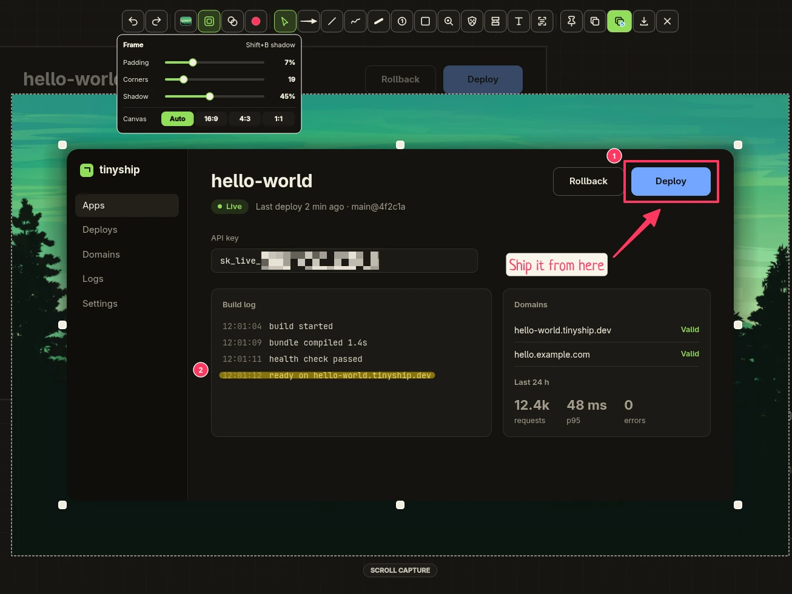
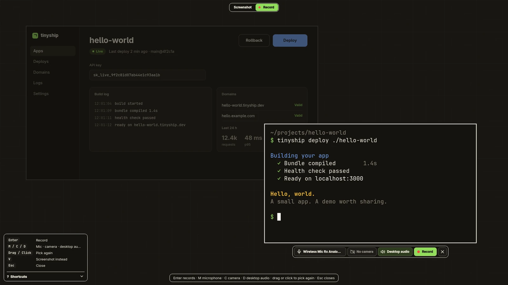
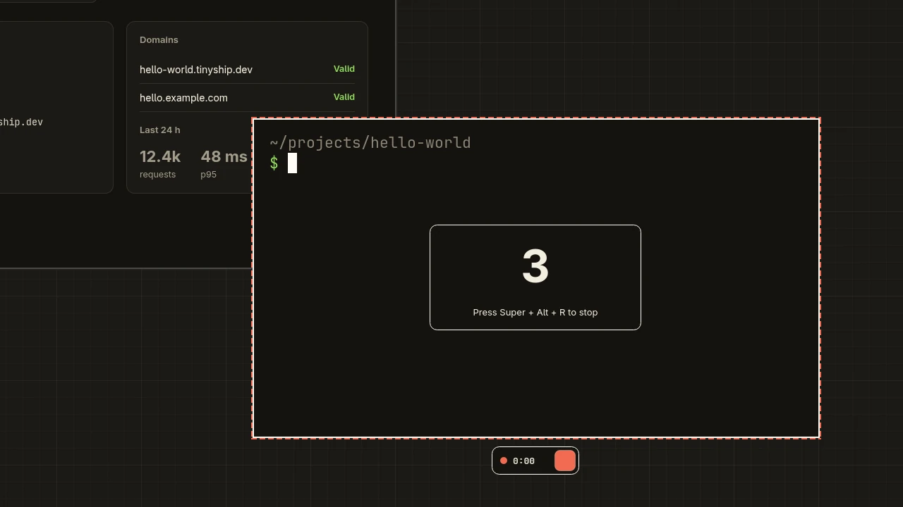
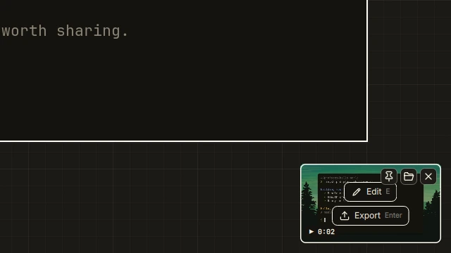

# OmaCap

Screen recordings and screenshots worth sharing. Made for Omarchy.

Press a key and pick an area. A screenshot is copied the moment you click, already framed like your last one. A recording gets a short editor: trim it, give it a background, padding and smooth zooms, and export an MP4 or GIF for a demo, tutorial or product update. Everything stays on your computer.

OmaCap is built on [Omasnap](https://github.com/omacom/omasnap), Omarchy's screenshot tool, so its picker, annotation tools, pins and keys work the same way here.

[Install](#install) · [Screenshots](#take-a-screenshot) · [Recordings](#record-your-screen) · [MIT license](https://github.com/allisonmahmood/omacap/blob/main/LICENSE)


*The real video editor, shown with a generated terminal demo.*

## A short edit, then you're done

- **One picker for both.** The screen freezes: drag an area, click a window, or click empty space for the whole monitor. `V` switches between a screenshot and a recording.
- **Make it look right.** A backdrop (your Omarchy wallpaper by default), padding, rounded corners, a shadow and optional window transparency. New screenshots start with the look you used last.
- **Keep the useful parts.** Trim the ends, split and delete mistakes in the middle, and undo when you change your mind.
- **Zoom on purpose.** Add a zoom at the playhead and aim it on the preview. OmaCap pans smoothly between zooms.
- **Include yourself when you want.** Record your microphone, desktop audio and camera. Place the camera, choose a rectangle or circle, and mute either audio track.
- **Mark up screenshots.** Arrows, boxes, text, numbered steps, highlighter, spotlight, redaction, cut-out bands, OCR, scrolling capture and pins, all from Omasnap.
- **Take the file anywhere.** MP4 or GIF at your chosen size and frame rate. No account, upload or project library.

The controls follow your Omarchy theme, live.

## Install

Download the x86_64 `.pkg.tar.zst` file and `SHA256SUMS` from the [latest GitHub release](https://github.com/allisonmahmood/omacap/releases/latest). In the download directory, verify and install the package:

```sh
sha256sum --check --ignore-missing SHA256SUMS
sudo pacman -U ./omacap-*.pkg.tar.zst
```

Keep only the package version you want to install in that directory. Pacman installs its dependencies. Release binaries target current Omarchy stable on x86_64. Update Omarchy through its normal update menu before installing a new OmaCap release.

Open **OmaCap** from your application launcher to take a screenshot; its **Record screen** action runs `omacap --record`. To open a recording or screenshot you already have, run `omacap /path/to/video.mp4` or `omacap /path/to/shot.png`.

For updates, download and install the newer package using the same steps. GitHub releases do not update through Omarchy or `yay`; you can subscribe with **Watch > Custom > Releases** on this repository. AUR distribution is not available yet. Uninstall with `sudo pacman -R omacap`.

### Bind keys

Add two bindings to `~/.config/hypr/bindings.lua`, then run `hyprctl reload`. Print stays with Omarchy's own screenshot tool:

```lua
o.bind("SHIFT + PRINT", "OmaCap screenshot", "omacap")
o.bind("ALT + SHIFT + PRINT", "OmaCap record", "omacap --record")
```

Each key toggles. The screenshot key closes an open picker, and the record key stops a recording. Keep "OmaCap" and "record" in the record binding's description: the countdown finds the key by its description and tells you how to stop.

### Build from source

On current Omarchy, with Arch's `base-devel` and `git` installed:

```sh
git clone https://github.com/allisonmahmood/omacap.git
cd omacap
./scripts/package.sh -si
```

This builds the committed checkout and installs its dependencies. OmaCap targets Hyprland and PipeWire on current Omarchy. Other desktops and distributions are not tested.

## Take a screenshot



*The real screenshot editor, shown with a generated dashboard.*

Run `omacap`, or press your screenshot key. The screen freezes under the picker: drag an area, click a window, or click empty space for the whole monitor. It opens on the focused monitor; move the pointer to another one and it follows, until you start picking. The shot is copied and saved straight away, wearing the look you used last, and a preview appears in the corner. Hover it to edit, copy, pin or drag out the file. It fades after 10 seconds unless you pin it.

Press `E` in the picker to open the editor instead. `Tab` cycles the area's shape (free, square, 3:4, 16:9), `R` brings back the last area, and `S` captures a scrolling region and stitches it into one tall image. The stack on the right edge holds your last five shots; click one to reopen it with its marks still editable.

`omacap shot.png` opens an image you already have, and `omacap --clipboard` opens the one on the clipboard. OmaCap edits its own copy, so the original never changes.

### Style and annotate

The editor draws over your desktop. `W` moves it into a normal window and back. The look lives in three toolbar popovers:

- **Backdrop**: your Omarchy wallpaper, Omasnap's slate and gradients, a colour, an image, or off. `B` cycles through them.
- **Frame**: padding, corners and shadow (`Shift+B` toggles the shadow), and the canvas. **Auto** fits the shot plus its padding; **16:9**, **4:3** and **1:1** suit posts.
- **Glass**: the window opaque, light (96%) or a custom opacity, so the backdrop shows through.

| Key | Tool |
| --- | --- |
| V | Select. Drag to move, use a handle to resize, Delete removes. Arrow keys nudge 1 px, or 10 px with Shift. |
| A | Arrow. Press again for pointy, curved and double arrows. |
| L | Line. Hold Shift to snap to 45°. |
| R / E | Rectangle / ellipse. Hold Shift for a square or circle. |
| T | Text on a pill. Press again for plain text; `Shift+T` changes the font. |
| C | Numbered step. Steps renumber when one is deleted. |
| F / H | Pen / highlighter. The highlighter snaps to a line of text. |
| S | Spotlight. |
| D | Redact. Press again to switch between mosaic and solid. |
| X | Cut out a band and close the gap. Hold Ctrl to insert one instead. |
| O | Recognise all text and copy it. |
| 1–8 | Colour of the selected mark and the next one. |

| Key | Output |
| --- | --- |
| Enter | Copy and save |
| Ctrl+C / Ctrl+S | Copy only / save only |
| Ctrl+Shift+S | Save as |
| P | Pin it on screen |
| Ctrl+Z / Ctrl+Shift+Z | Undo / redo |
| Esc | Close; the shot stays in the stack on the right |

Screenshots are saved as `omacap-<date>_<time>-<app>.png` in `$OMARCHY_SCREENSHOT_DIR`, or `~/Pictures/Screenshots`. The picker and editor list their keys in a card at the bottom left, folded until you press `?` or click it. [Omasnap's README](snap/README.md#controls) lists every key and modifier.

## Record your screen

### 1. Pick an area

Run `omacap --record`, press your record key, or press `V` in the screenshot picker. Drag an area, click a window, or click empty space for the whole monitor. A bar appears beside it: click your microphone, camera and desktop audio, or press `M`, `C` and `D`. OmaCap remembers them. Press Enter or click **Record**.



### 2. Record

A three-second countdown runs over the area, then recording starts. Press your record key again to stop.



Nothing of OmaCap ends up in the file. The recording is cropped to the area as it is captured, and the outline and timer sit outside it, or on another monitor. When you record a whole monitor and have no other, they aren't shown.

The first time you record each monitor, Hyprland's screen-share picker asks what to share. Pick that monitor; OmaCap remembers it. The area is fixed on the screen, so move a window and the area stays put. Rotated monitors can't be recorded yet.

### 3. Keep, export or edit

When you stop, a card with the first frame appears in the corner. It doesn't take the keyboard until you hover it.



| Key | On the card |
| --- | --- |
| Enter | Export with your last export settings, to your Videos folder |
| E | Edit |
| P | Keep the card on screen |
| X / Esc | Close |

The card fades after 10 seconds unless you hover it, keep it or export. The recording itself is always kept in your Videos folder as `omacap-<date>_<time>.mkv`.

### 4. Edit

The editor draws over your desktop like the screenshot editor; `W` moves it into a window and OmaCap remembers which you prefer. The toolbar holds undo and redo, the look (backdrop, frame, glass, camera), the tools (select, crop, zoom, cut), and export and close.

- **Crop** opens the whole recording. Drag the corners to resize the selection, or drag inside it to move it, then **Confirm crop**. Reopening Crop always shows the full recording, so you can expand an earlier crop.
- **Look**: the backdrop is your wallpaper, an image or a colour; the frame sets padding, corners and shadow; glass shows the backdrop through the recorded window. The camera stays opaque. If you recorded a camera, its popover sets its size, shape, corners and shadow, and you can drag it in the preview. New recordings keep your last frame and camera settings.
- **Trim and cut.** Drag across a lane to select a range, then **Keep range** or **Delete**. `S` splits at the playhead. The cut tool (`C`) splits a track where you click; `V` returns to select. Click a clip and press Delete to remove it. The microphone and speaker buttons mute either track.
- **Zoom.** Press `Z`, or click an empty part of the Zooms lane. Select a zoom and the preview lights the area it zooms to: drag it to aim, and use the wheel or a corner to change the amount. Drag the zoom on the timeline, or its ends, to time it. Touching zooms move straight from one target to the next.


### 5. Export

Click **Export** or press `E`. Choose MP4 or GIF, the width, frame rate and, for MP4, the quality, then **Choose file and export**. MP4 is H.264 with AAC audio; a GIF is a silent loop of the whole edit. Both are 16:9. OmaCap shows the file size when it finishes, warns when a GIF is over the 10 MB that GitHub and Discord accept, and remembers your choices for the card.


There is no project file. Export leaves the editor open so you can export again. Closing asks first if you changed anything since the last export. If OmaCap closes before you export, the next `omacap --record` shows the unfinished edit on a card first: **Recover** opens it, **Discard** drops it.

| Action | Key |
| --- | --- |
| Play / pause | Space |
| Step a frame | Left / Right |
| Backdrop, frame, glass, camera | B, F, G, P |
| Crop; confirm it | K; Enter |
| Split at the playhead | S |
| Add a zoom at the playhead | Z |
| Cut / select tool | C / V |
| Delete the selected clip, range or zoom | Delete / Backspace |
| Export | E |
| Window or overlay | W |
| Undo / redo | Ctrl+Z / Ctrl+Shift+Z |
| Back out of a popover, selection or crop, then close | Esc |

### Limits

This version targets short SDR demos on a 16:9 canvas. Zooms are manual, and real camera and microphone synchronisation should be checked with your own devices.

## Files and settings

- **Recordings**: `~/Videos/omacap-<date>_<time>.mkv`. The card's export writes `~/Videos/Demo-<date>-<time>.mp4` (or `.gif`); the editor's goes where you choose.
- **Screenshots**: `$OMARCHY_SCREENSHOT_DIR`, or `~/Pictures/Screenshots`.
- **Settings**: optional, in `~/.config/omacap/omacap.conf`, for screenshots. It takes [Omasnap's keys](snap/README.md#configuration-optional) except `[background]`, and `OMACAP_SCREENSHOT_DIR` overrides the folder.
- **State**: the last look, your recording devices, recent shots and backdrop pictures, in `~/.local/state/omacap/`.

## Development

C++20 and Qt 6, built with CMake and Ninja. `snap/` is the Omasnap-derived capture side: the picker, screenshot editor, previews and pins. `src/` and `qml/` are the video side: recording, the card, the video editor and exports. Python and GStreamer capture through the screen-cast portal; system FFmpeg encodes exports; Tesseract reads text. See [how OmaCap fits together](docs/architecture.md), [what OmaCap changed in Omasnap](snap/VENDORED.md), and [the package recipe](packaging/PKGBUILD.in) for dependencies.

```sh
./scripts/build.sh
./build/omacap
./scripts/test.sh
```

Tests also need `python-numpy`. `test.sh` runs Omasnap's smoke tests offscreen, then the integration suite: synthetic capture, timeline gestures, waveforms, recovery, preview/export consistency, cancellation and audio/video timing. CI builds packages against Omarchy stable and latest Arch, runs the tests under Xvfb, and installs and launches each package in a fresh container. Recording through the real portal is tested locally, as below.

To try OmaCap on a real compositor without touching your session, `scripts/nested-hyprland.sh start <dir>` runs a nested Hyprland in a hidden window and prints the `WAYLAND_DISPLAY` and `HYPRLAND_INSTANCE_SIGNATURE` to use. `scripts/nested-portal.sh start <dir>` adds a private screen-cast portal with a scripted picker, and `tests/record-nested.py <dir>` records through it and checks that no OmaCap pixel is saved. Give OmaCap its own `OMACAP_RUNTIME_DIR` and XDG directories there, so it can't reach a running OmaCap. The headers of these scripts explain the rest.

In T3 Code, import **Build and run** and **Run tests** from **From t3.json** in the project scripts menu. The shared configuration also sets the OmaCap project icon. Both actions run on demand in the current thread's checkout.

For a per-user install, run `./scripts/install-local.sh` instead of installing the Arch package. It builds OmaCap and ends by printing the installed version. Its `~/.local/bin/omacap` and desktop entry take precedence over the package, so remove them when you switch to the package.

See [Releasing OmaCap](docs/releasing.md) for preparing a draft release and publishing it on GitHub.

## License

[MIT](https://github.com/allisonmahmood/omacap/blob/main/LICENSE). `snap/` is derived from [Omasnap](https://github.com/omacom/omasnap), MIT licensed, © 2026 Tobi Lütke ([its licence](snap/LICENSE)); its bundled fonts keep their OFL licences and its Lucide icons their ISC licence. Multimedia dependencies retain their own licenses. OmaCap is independent and contains no Cap code or assets.
